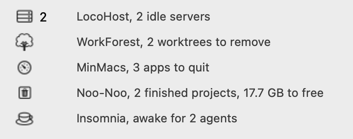
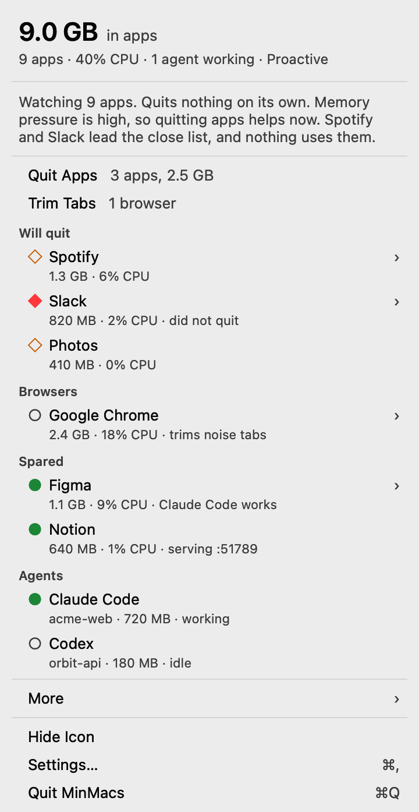
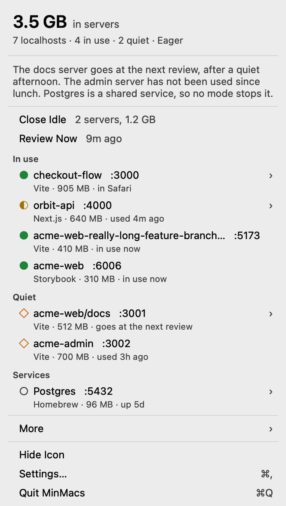
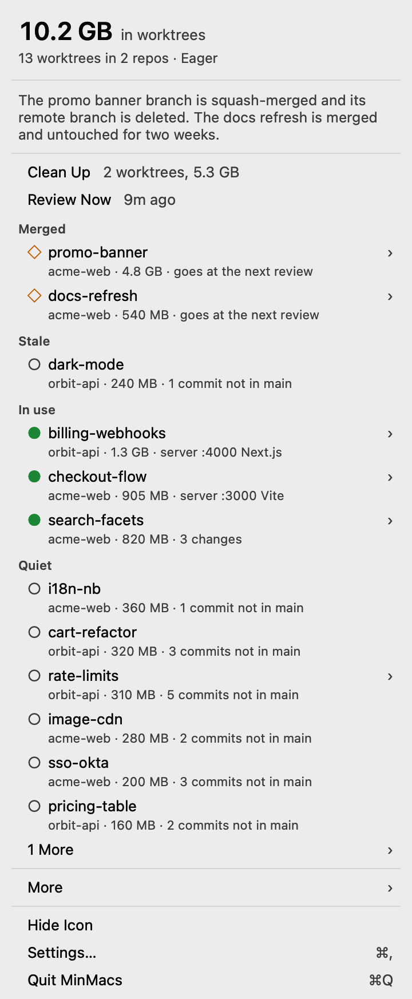
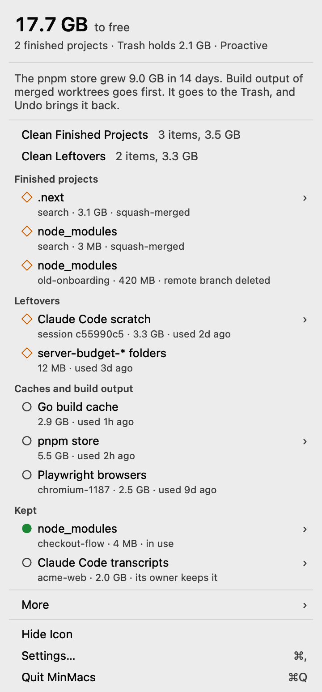
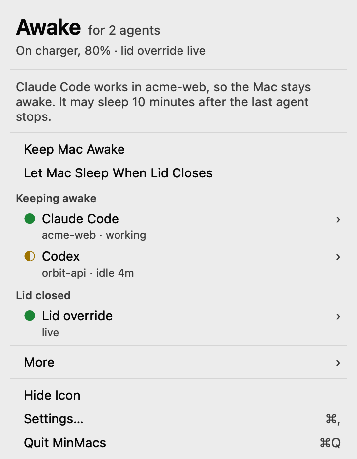
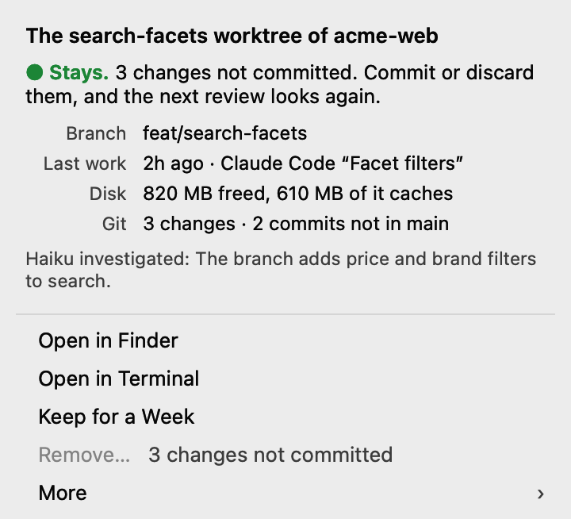

<p align="center"></p>

# MinMacs

MinMacs 2.0 is one macOS menu bar app for a Mac that runs coding agents. It joins five apps that used to run on their own: MinMacs, LocoHost, WorkForest, Noo-Noo and Insomnia. Each one is now an expert inside MinMacs, with its own icon, menu and CLI verbs. All five read one shared core that samples the Mac once every 5 seconds, so the Mac pays for one sampler and not five.

MinMacs 2.0 is built on `main` and is not released yet. MinMacs 1.2 lives on the [`legacy`](https://github.com/FRIKKern/minmacs/tree/legacy) branch, and `install.sh` installs 1.2 from there by default. See [Install](#install).

<picture>
  <source media="(prefers-color-scheme: dark)" srcset="docs/img/status-dark.png">
  
</picture>

Every picture on this page is a PNG from `tools/render.sh`, which draws each expert's menu and cards from made-up fixture subjects with the same kit the app uses. No real Mac was scanned for them.

## The five experts

| Expert | What it watches | What it can do | Old app |
|---|---|---|---|
| MinMacs | Running apps, their memory and CPU, and the agents that use them | Quit apps on the close list, trim noise tabs in browsers, restore both | MinMacs 1.2 |
| LocoHost | Every server on a localhost port: what runs, in which folder and branch, who uses it | Stop a dev server nobody uses, start it again | LocoHost 0.1 |
| WorkForest | Every git worktree: merged or not, what it holds, what removing it frees | Remove a merged worktree, and recreate it at the same commit | WorkForest 0.1 |
| Noo-Noo | Caches, build output and leftovers of agents and tools | Move them to the Trash, or run the tool's own clean command after a recovery copy | Noo-Noo 0.7 |
| Insomnia | Agents that work right now, power, battery, lid and heat | Keep the Mac awake while an agent works, and let it sleep when none does | Insomnia 1.3 |

Each expert has three modes. Idle acts on nothing. Proactive, the default, acts on what is clearly safe. Eager also acts on what the judge, a second model call, lets go. No mode acts on its own during the first day after the first launch. Every action is checked again right before it runs, writes an undo record first, and goes to the Trash, to a recovery folder or through the owning tool's own command.

<table>
<tr>
<td valign="top"><picture><source media="(prefers-color-scheme: dark)" srcset="docs/img/minmacs-menu-dark.png"></picture></td>
<td valign="top"><picture><source media="(prefers-color-scheme: dark)" srcset="docs/img/locohost-menu-dark.png"></picture></td>
</tr>
<tr>
<td valign="top"><picture><source media="(prefers-color-scheme: dark)" srcset="docs/img/workforest-menu-dark.png"></picture></td>
<td valign="top"><picture><source media="(prefers-color-scheme: dark)" srcset="docs/img/noonoo-menu-dark.png"></picture></td>
</tr>
<tr>
<td valign="top"><picture><source media="(prefers-color-scheme: dark)" srcset="docs/img/insomnia-menu-dark.png"></picture></td>
<td valign="top"><picture><source media="(prefers-color-scheme: dark)" srcset="docs/img/workforest-card-search-dark.png"></picture></td>
</tr>
</table>

A row's hover card says whether the item stays or goes and why, with at most five facts. A fact that belongs to another expert links to that expert's card. Settings has "One Icon", which puts all five menus into one flat menu. [docs/DESIGN.md](docs/DESIGN.md) is the standard every menu follows.

## Install

MinMacs needs macOS 14 or newer and Apple's Command Line Tools. It builds from source with clang alone, with no Swift, packages or Xcode project.

MinMacs 2.0 from a checkout:

```sh
git clone https://github.com/FRIKKern/minmacs.git && cd minmacs
./build.sh             # a universal build into build/MinMacs.app; installs nothing
./test.sh              # the checks, on fixtures only
./build.sh --install   # replaces ~/Applications/MinMacs.app and links ~/.local/bin/minmacs
```

`install.sh` builds and installs MinMacs 1.2 from the `legacy` branch unless `MINMACS_REF` names another ref:

```sh
curl -fsSL https://raw.githubusercontent.com/FRIKKern/minmacs/main/install.sh | sh
```

## The CLI

The app binary is also the command line tool. When the app runs, the CLI hands each verb to it over a socket in the support folder. When no app answers, it builds a snapshot itself. A verb that changes things needs the running app, unless `--dry-run` is given. Every verb takes `--json`.

```sh
minmacs status                  # what each expert sees, as its menu header says it
minmacs hosts 3000              # what runs on port 3000, how it runs and why
minmacs trees list              # every git worktree and whether it is merged
minmacs tidy --dry-run          # what each expert's mode would act on now
minmacs restore --list          # the undo records
minmacs investigate <path>      # the folders, the question and the cost; --yes runs it
```

[docs/CLI.md](docs/CLI.md) lists every verb and flag. It is generated from `minmacs help --json`, and `./test.sh docs` fails when it does not match the binary.

## The old names

- **Commands.** A link to the binary named `locohost`, `workforest`, `noo-noo` or `insomnia` answers that expert's verbs first. The commands of MinMacs 1.2 and WorkForest 0.1, such as `minmacs plan` and `workforest list`, are rewritten to 2.0 verbs. [docs/CLI.md](docs/CLI.md#the-old-names) lists each one.
- **URLs.** The app answers `minmacs://` and `locohost://`. `minmacs://<expert>/<command>` reaches any expert.
- **State.** On first launch Core imports the rules, prefs and records of MinMacs 1.2 and LocoHost once. It only reads their files and prefs. `Sources/Core/Store/MMMigrate.m` holds the import.

## What it costs at rest

From [docs/2.0/BENCH.md](docs/2.0/BENCH.md): thirty minutes of `tools/bench/run.sh` on a MacBookPro18,1 with all five experts in Idle mode, while other builds ran on the same Mac.

| | Measured | Budget |
|---|---|---|
| Idle CPU | 0.291 % | 0.3 % |
| CPU a tick, from one sample to the next | 14.545 ms | 15 ms |
| Footprint | 10.70 MB, peak 12.47 MB | 45 MB |
| Wakeups a second | 0.223 | under 1 |

The bench runs Core and the experts in one process with no status item, menu or window, so the app's own footprint is higher. It has not been measured yet.

## The review

Some decisions need judgment, such as whether a quiet dev server is still wanted. One review broker in Core asks the model for every expert, through the `claude` or `codex` CLI on the person's own login. Rules and a cache of earlier answers decide most findings first, so only what changed is sent. On a generated day of findings for all five experts, the broker sent 56,846 uncached tokens, 3.1 % of what the old apps' way of asking sent for the same day. [docs/REVIEW.md](docs/REVIEW.md) explains how. [docs/PRIVACY.md](docs/PRIVACY.md) lists every field each expert sends.

## More

- [docs/HOW-IT-WORKS.md](docs/HOW-IT-WORKS.md): Core and the experts, for a reader who does not read the code.
- [docs/REVIEW.md](docs/REVIEW.md): the review broker, triage, fingerprints, fact blocks and Investigate, with the token numbers.
- [docs/PRIVACY.md](docs/PRIVACY.md): what is sent to the model, field by field, and what is redacted.
- [docs/CLI.md](docs/CLI.md): every verb and flag.
- [docs/DESIGN.md](docs/DESIGN.md): the menu standard.
- [docs/2.0/PLAN.md](docs/2.0/PLAN.md): the plan and the decisions.
- [AGENTS.md](AGENTS.md): the layout and rules for agents that work on the code.

## License

MIT. Made by [Frikk Jarl](https://github.com/FRIKKern).
